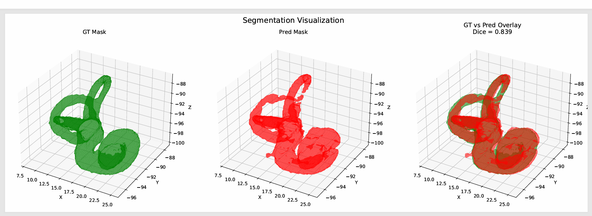

# CT-Based Cochlear Implant Surgical Planning (Research Prototype)

An end-to-end deep learning pipeline that takes a temporal-bone CT scan and produces a PDF planning report: inner-ear segmentation, surgical landmark localization, and a relative anatomical-complexity score. It is served through a FastAPI web app.

> **Research prototype. Not a medical device and not for clinical use.** It was trained on a very small dataset and has no surgeon-validated outcome labels. See [Limitations](#limitations).



*Example test case: ground-truth inner-ear mask (left), predicted mask (middle) and overlay (right), Dice = 0.839 for this case.*

<!-- Add more screenshots: docs/ui.png, docs/sample_report.pdf -->

## What it does

```
CT scan (.nii)
   │
   ├─► 2.5D U-Net ──────────► inner-ear segmentation mask (largest component kept)
   │
   ├─► 3D U-Net (heatmaps) ─► 5 landmarks: RW, C, A, OW, V   (world coordinates, mm)
   │
   └─► Geometric features ──► relative complexity score ──► label + PDF report
        (landmark distances, mask compactness, connected components)
```

1. **Segmentation.** A small 2D U-Net takes 3 adjacent slices (2.5D) and predicts the inner-ear mask. The 3D result keeps only the largest connected component.
2. **Landmark localization.** A 3D U-Net regresses one Gaussian heatmap per landmark (Round Window, Cochlear center, Apex, Oval Window, Vestibule). The heatmap argmax is mapped back to world coordinates through the CT affine.
3. **Complexity score.** A weighted sum of z-scored features (`dist_C_RW`, `dist_C_OW`, `dist_RW_OW`, `landmark_span`, `compactness`, `num_components`) is computed against the training cohort and cut at the 33rd and 66th percentiles into three labels.
4. **Report.** A multi-page PDF with the summary, 3D mask visualization, CT overlays, the full score calculation, and a limitations page.

## Example report

Page 1 of the generated PDF for a test specimen (T06). The label compares the case to the training cohort and is not a clinical risk rating. The full report also includes 3D mask views, CT overlays, the complete score calculation and a limitations page.


## Results

Evaluated on 5 held-out specimens (F14, F15, T06, T07, T08). Split: 15 train / 3 validation / 5 test.

| Task | Metric | Test result |
|---|---|---|
| Segmentation | Dice (per-slice, on slices containing the structure) | 0.756 |
| Landmarks | Mean error, all 5 landmarks | 5.54 mm |

Per-landmark mean error: RW 5.41 mm, C 5.83 mm, A 5.91 mm, OW 4.29 mm, V 6.28 mm.

The figure above shows the full-volume 3D result for a single specimen (Dice 0.839). The table reports the per-slice average over all test specimens, so the two are different measures and the 3D value is not a cohort average.

These are small-sample numbers (5 test specimens, one at roughly 9 mm error). Treat them as a feasibility result, not as a benchmark.

## Project structure

```
app.py                      FastAPI server (web UI, /predict, /generate-report, /health)
pipeline.py                 inference, risk scoring, visualization, PDF report
models.py                   UNetSmall (2.5D) and UNet3D
Dockerfile                  container image for the web app
requirements.txt            Python dependencies
notebooks/
  01_segmentation_training.ipynb
  02_landmark_heatmap_training.ipynb
  03_end_to_end_demo.ipynb
weights/                    trained model weights
risk_profile.json           training-cohort statistics used by the score
static/                     web UI assets
```

## Dataset

Data comes from the public dataset at https://zenodo.org/records/3355272 (CT scans, micro-CT label masks and landmark annotation files for ex-vivo specimens). **The data is not included in this repository.** Download it yourself and check the license on the Zenodo page.

Expected layout:

```
DATASET_ROOT/
  F01/
    CT/F01_CT_RAW.nii
    UCT/F01_uCT_LABELS.nii
    F01_DESC.json
  ...
```

Subject split used: train `F01–F10, T01–T05`, validation `F11–F13`, test `F14–F15, T06–T08`.

## Setup

```bash
git clone https://github.com/MohamedRasmyy/cochlear-ct-planning.git
cd cochlear-ct-planning
python -m venv .venv && source .venv/bin/activate
pip install -r requirements.txt
```

Place the weights in `weights/` (or set the environment variables below).

## Run the app

```bash
export SEGMENTATION_WEIGHTS=weights/unet_final.pth
export LANDMARK_WEIGHTS=weights/best_landmark_model.pth
uvicorn app:app --host 0.0.0.0 --port 8000
```

Open http://localhost:8000, upload a `.nii` / `.nii.gz` CT, and download the PDF report.

| Endpoint | Purpose |
|---|---|
| `GET /` | Web UI |
| `POST /predict` | CT only, returns a prediction-only PDF |
| `POST /generate-report` | CT plus optional mask and description, returns a full PDF with Dice and landmark error |
| `GET /health` | Model and config status |

## Docker

```bash
docker build -t cochlear-ct-planning .
docker run -p 8000:8000 cochlear-ct-planning
```

Then open http://localhost:8000. The image uses CPU-only PyTorch and includes the weights from `weights/`.

## Training

Run the notebooks in order, with `DATASET_ROOT` pointing to the data:

1. `01_segmentation_training.ipynb`: 2.5D U-Net, Dice + BCE loss, 25 epochs, Adam (lr 1e-4). Saves `unet_final.pth`.
2. `02_landmark_heatmap_training.ipynb`: 3D U-Net on volumes resized to 96×128×128, Gaussian heatmaps (σ = 2.5), MSE loss, 40 epochs. Saves `best_landmark_model.pth`.
3. `03_end_to_end_demo.ipynb`: fits the risk profile, runs the full pipeline on a test case, and generates a report.

## Limitations

- **Tiny dataset.** 15 training specimens. Weights and thresholds are fitted to them and need validation on a larger cohort.
- **Labels are relative.** `SAFE`, `MODERATE` and `HIGH RISK` come from percentile cut points of the training scores, so they describe how a case ranks against the training cohort, not an absolute or clinical risk. Reports display them as favorable, intermediate and challenging anatomy.
- **No outcome validation.** There are no surgeon-validated outcome labels. The score is a geometric proxy and not a surgical safety predictor.
- **In-sample profile.** The risk profile is computed on the same specimens the models were trained on, so its statistics are optimistic.
- **Segmentation metric.** Dice is computed per 2D slice on slices that contain the structure, which is more favorable than a full-volume 3D Dice.
- **Landmark error of about 5 mm** is large relative to inner-ear structures and affects the score.

## Tech stack

Python, PyTorch, nibabel, SimpleITK, SciPy, pandas, Matplotlib, FastAPI.

## License

Code: [MIT License](LICENSE). The dataset has its own license; see the Zenodo record.
